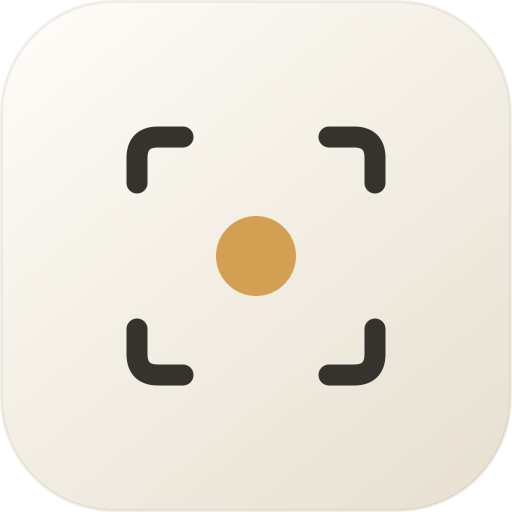
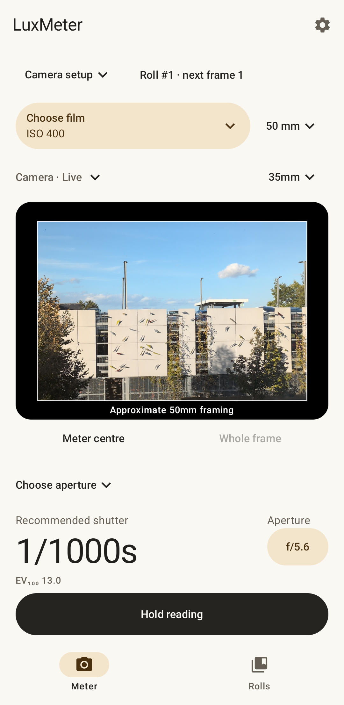

<p align="center">
  
</p>

<h1 align="center">LuxMeter</h1>

<p align="center">
  An Android exposure companion for film photography.<br>
  Compose a frame, read the exposure, hold it, and optionally save the frame to a roll.
</p>

<p align="center">
  
</p>

<p align="center"><sub>Live camera metering on a Pixel 9 Pro Fold.</sub></p>

## Shooting

1. Choose your film and shooting speed. In **Film & speed**, choose **Normal** or a push of **+1 to +4 stops**; the app previews the shooting EI and processing to request from your lab. A two-stop push of ISO 400 film meters at EI 1600. Apply with **Use for this roll**; closing the sheet discards your draft. Custom shooting ISO stays available and keeps the film's reciprocity profile without inferring a processing instruction. Optionally save a named camera setup with its real shutter speeds, aperture range, format and lens.
2. Point the camera at the scene inside the outlined frame. Tap a subject to measure a selected area, or use **Meter centre**. **Whole frame** restores frame metering. The visible area is approximate phone metering, not a dedicated one-degree spot meter.
3. Choose an aperture to get a shutter recommendation, or switch to shutter priority or manual exposure. The shutter you choose in those modes is the actual exposure duration; film correction is included when calculating aperture or exposure balance.
4. Use **Exposure adjustments** for compensation in thirds of a stop and a filter on the film camera. Positive compensation gives more exposure. Filter and scene adjustments apply before film reciprocity correction and remain visibly labelled until reset.
5. Tap **Hold reading** to freeze the exposure and camera preview. The complete held exposure stays beside Resume. Format, lens and measuring area stay locked until you resume.
6. Optionally **Save frame**, with **Undo** if it was accidental. If correction is unavailable, **Record manual exposure** saves the actual settings you choose with a manual label.

The primary navigation is **Meter** and **Rolls**. Settings contains calibration, haptics, and film management. Sunny 16 is an explicit estimate tool. Depth of field expands on the meter; the long-exposure timer appears when needed.

## Metering and calibration

Camera metering requests an auto-exposure region matching the outlined preview. It verifies the reported region and exposure convergence, then derives EV100 from the camera's reported shutter duration, sensitivity, aperture, and post-RAW gain. Missing data or unsupported region metering produces an unavailable state, not a fabricated reading.

Phone camera auto-exposure remains a device-dependent estimate. Compare the phone against a reference meter before relying on it for film. Hold a camera or light-sensor reading, then use **Compare with a reference meter** in Settings to enter the reference aperture, shutter and ISO. The proposed offset replaces that measuring source's calibration; camera and sensor offsets are separate. A manual adjustment remains available. Lens framing is approximate and bounded by the phone's zoom capability. Frame geometry and exposure mathematics have unit coverage; a successful build does not establish hardware accuracy.

Camera EV and original sensor lux are retained without clipping. A zero-lux sensor result is unavailable rather than a fabricated exposure. Phones with ambiguous focal-length metadata use phone framing instead of claiming a simulated film-camera lens.

The light-sensor mode measures light reaching the phone, rather than a camera composition. It uses actual on-change sensor values and remains separate from camera readings. Sunny 16 estimates do not inherit device calibration. Changing film format or lens preserves sensor and Sunny 16 readings.

Calibration stays on the device and is excluded from backup and transfer. The old backed-up calibration value is reset once on upgrade because its originating phone cannot be identified; a nonzero reset prompts recalibration.

## Film correction limits

The film picker includes 27 built-in presets with dimensional canister artwork in the app's light and dark themes. Search by film, brand or speed, filter color, black-and-white or slide film, and expand the grid to browse the complete library. Custom films remain available alongside the presets.

HP5 and Delta 3200 use [Ilford's published powers](https://www.ilfordphoto.com/wp/wp-content/uploads/2024/05/Reciprocity-Failure-Compensation-v2.pdf). Tri-X uses [Kodak's published timed points](https://www.kodakprofessional.com/sites/default/files/wysiwyg/pro/resources/f4017_TriX.pdf), with estimated interpolation and a development-adjustment reminder. CineStill 800T uses its approximate power of 1.3 and explicitly asks you to bracket.

The additional presets support their stated ordinary-exposure ranges without inventing longer correction curves; **Film details** shows each limit and source. ColorPlus 200 is explicitly labelled **Short-exposure estimate**: it assumes ordinary exposure through one second because no manufacturer reciprocity range is supplied. Its linked catalogue establishes ISO, not a validated correction range.

Kodak color films have no manufacturer-supplied timed correction beyond their stated normal range. Superia and Velvia publish aperture corrections, and Velvia also needs color filtration. Outside a supported timed range, the app shows the metered value and guidance, suppresses the corrected recommendation, and disables timing and saving that recommendation. You can explicitly record a manually chosen exposure instead. Corrected exposures and the foreground timer are limited to one day.

An unlisted film needs only its name and ISO; film type and brand can be supplied. Its correction starts as **Unknown**. An optional tested power-law profile can use your own exponent. **Film details** distinguishes manufacturer guidance, estimates and your tested profile, with supported ranges and source links. Unknown profiles never invent a corrected duration.

## Remembered setup and rolls

Film, ISO, format, lens, exposure mode, adjustments, calibration, haptics, and the active roll are restored between sessions. Named cameras constrain recommendations to their own aperture and shutter values; enable **Bulb** only if the camera supports longer exposures. Out-of-range automatic recommendations are unavailable rather than silently treated as correct.

Aperture priority chooses an actual shutter-dial value using the film's inverse correction. Supported Bulb exposures of at least one second use the continuous corrected time, avoiding an extra rounding step before film correction. The meter labels Bulb when needed and shows the remaining exposure error when a dial value rounds the target.

Room stores explicit loaded and finished rolls as well as profiles and exposure records. **Continue this roll** restores its camera, film, ISO and progress. **Finish roll** retains its frames; **Reopen roll** resumes it. Set the last physical frame already exposed to catch up after shooting without logging, and choose the actual roll capacity. Frame edits cannot move behind saved photographs. Switching the meter to another camera or film does not relabel a nonempty roll; choose a compatible roll before saving.

Push processing is a roll setting, separate from exposure compensation and filters. New rolls default to Normal processing and the selected film's box speed. Changing a populated roll's shooting speed or processing through **Edit film and processing** requires confirmation because development affects the whole physical roll; existing frame exposure snapshots stay unchanged. Ordinary ISO adjustments do not silently rewrite that roll's plan. Roll details and CSV exports retain the requested processing, and continuing a roll restores it. Older rolls keep their existing shooting ISO with processing marked **not specified** until explicitly chosen.

Push choices record your intended processing; they do not supply development times or certify that a film/lab combination supports the push. Long-exposure correction continues to use the film profile and its existing limits.

Calculated saving requires a valid held reading and supported correction. Manual records are clearly marked and include reference meter data only when a reading is held. Both reject repeated taps and confirm only after storage succeeds. The frame and physical counter commit together. The version 1 to 2 migration preserves existing profiles, record IDs and exposure snapshots, and adopts the active roll from its remembered setup. Built-in profile repair still completes transactionally before queries.

Deleting a saved record preserves the roll's physical frame counter. Undo reverses the most recent accidental save. Custom-film drafts remain available after a failed insert; locale decimal separators are accepted.

Tap a saved frame to edit its note without changing exposure data. **Share roll as CSV** opens Android's share sheet with a local file containing frame settings, camera/lens, adjustments, correction provenance, notes and UTC timestamps. Text is escaped for CSV and protected against spreadsheet formula interpretation. No account or upload service is required.

The timer compensates for delayed UI frames and configuration changes using elapsed time. Start and close the real camera's shutter separately. Keep the timer screen open while timing; it is not a background alarm service.

## Build and test

Requirements: JDK 17 or newer (tested with JDK 21), Android SDK platform 36.1, build tools 36.0.0, and an SDK location supplied through `ANDROID_HOME` or an ignored `local.properties`.

```sh
./gradlew :app:testDebugUnitTest :app:assembleDebug
```

The wrapper pins Gradle 9.3.1 and verifies its distribution checksum. Release builds use **com.nsheremet.luxmeter**. Debug builds use Android's standard debug signing configuration and install as **LuxMeter Preview** (`com.nsheremet.luxmeter.debug`), alongside the release app with separate storage. The APK is written to `app/build/outputs/apk/debug/app-debug.apk`.

These IDs identify new Android apps. Existing installations under `com.aistudio.luxmeter.analog` and `com.aistudio.luxmeter.analog.debug` remain separate, and their saved data does not move automatically to the new apps. Keep the old apps until you have backed up any records you need.

GitHub Actions runs unit tests, lint, a debug build, and the full Android UI test suite on an API 35 emulator for every push and pull request. The workflow also supports manual runs. Download **luxmeter-preview** for the debug APK or **android-test-reports** for results from the run's artifacts; they are retained for 14 days.

Tests cover exposure and depth-of-field calculations, selected-area camera crop/rotation/zoom geometry, metadata validation, source isolation and calibration, camera limits/Bulb, exposure/filter adjustments, held readings, loaded rolls, manual and calculated saving, notes/export, migration and transactional rollback, profile repair, backup exclusions, locale inputs, Sunny 16 choices, timer timing, and readable exposure controls.

Before relying on a release, verify camera permission/retry, frame alignment, rotation, held previews, daylight/low-light readings, font scaling, TalkBack, and calibration on physical devices.

## GitHub releases

Push a tag on a commit containing the release workflow to build and publish a signed APK after all CI checks pass:

```sh
git tag v1.0.1
git push origin v1.0.1
```

The release contains **LuxMeter-v1.0.1.apk** and generated release notes. The app version is the tag with an optional leading `v` removed; Android's version code uses the increasing GitHub Actions run number. All tag names trigger releases. Rerunning a published tag keeps its existing APK; a failed draft can resume uploading before publication.

Signing uses a stable PKCS12 keystore with alias `upload`, supplied through repository secrets **KEYSTORE_BASE64**, **STORE_PASSWORD**, and **KEY_PASSWORD**. The keystore is decoded only into the runner's temporary directory and removed after the job. Keep a secure backup of this key and its password: future updates to `com.nsheremet.luxmeter` must use the same signing key. The new app can be installed alongside the original app without removing its data.

## Technical foundation

Kotlin, Jetpack Compose Material 3, CameraX, StateFlow, and Room. Android 7.0 (API 24) or newer. The interface follows the system's light/dark appearance and adapts to wider screens.
